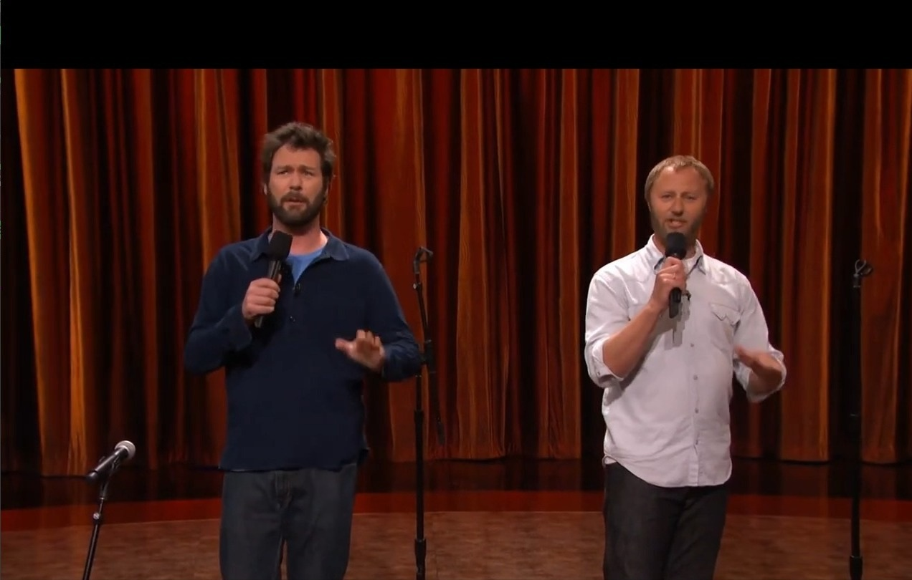
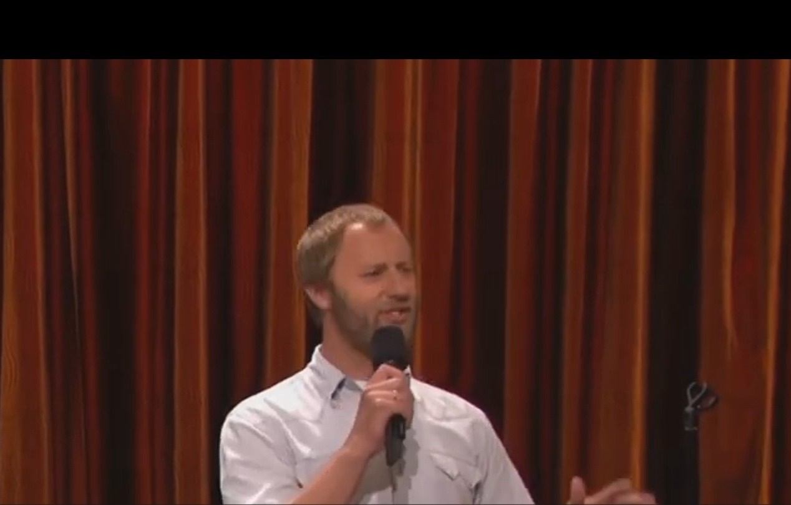
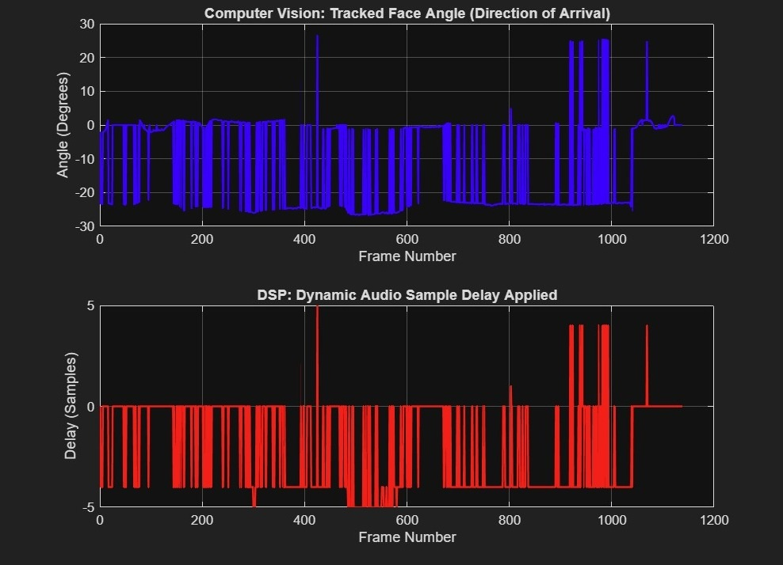

# Audio-Visual Zoom (AV Zoom)

Synchronizes computer-vision face tracking with DSP audio beamforming: as the video visually zooms in on the tracked speaker, the stereo audio is steered toward the same direction with a delay-and-sum beamformer. MATLAB implementation.

## What it does

Given a prerecorded `.mp4` with a true stereo audio track (2 distinct channels), `AV_ZOOM.m` processes it frame by frame:

1. Detects the speaker's face in each frame (`vision.CascadeObjectDetector`).
2. Maps the face's center pixel to a Direction of Arrival (DoA) angle, using the camera's field of view.
3. Visually zooms: crops the frame around the face's bounding box and resizes it back to the original resolution.
4. Converts the DoA angle into a Time Difference of Arrival (TDOA) between the two audio channels, from the mic spacing and the speed of sound, and rounds it to a whole-sample delay.
5. Applies delay-and-sum (DAS) beamforming: shifts the left or right channel by the computed sample delay, then averages the two channels.
6. Writes the cropped frame and the filtered audio chunk together into a single synchronized `.avi` output.
7. Logs the tracked angle and the applied delay per frame and plots both histories at the end.

The face tracker is the control signal for the beamformer: the steering direction follows the moving speaker through the sequence.

## Example run

Stereo video of two speakers on a stage, ~1,100 frames. Parameters: speed of sound 343 m/s, mic spacing 0.08 m, camera FOV 70 deg, zoom crop factor 0.5.

- Output: `Final_AV_Zoom.avi` - every frame dynamically cropped around the tracked speaker and resized to the original resolution, with the matching audio chunk shifted by the computed sample delay and averaged across the two channels.
- The logged histories (Fig. 3) show the applied integer sample delay following the tracked face angle over the full sequence (tracked angle mostly within +/- 25 deg, delays within +/- 5 samples).

## Figures

| | |
| --- | --- |
|  |  |
| Fig. 1: Frame from the input video showing both speakers. | Fig. 2: Frame from the output `Final_AV_Zoom.avi`, dynamically cropped around the tracked speaker and resized to the original resolution. |
|  | |
| Fig. 3: System analysis graphs - tracked face angle (Direction of Arrival) and the dynamic audio sample delay applied per frame. | |

## Requirements

- MATLAB with the Computer Vision Toolbox (`vision.CascadeObjectDetector`, `vision.VideoFileWriter`) and Image Processing Toolbox (`imcrop`, `imresize`)
- An input `.mp4` with a stereo audio track; mono input is rejected with an error

## Usage

1. Place your stereo `.mp4` next to the script (default name `input.mp4`) or set `inputFile` at the top of `AV_ZOOM.m`.
2. Tune `micSpacing`, `cameraFOV` and `zoomScale` for your recording.
3. Run `AV_ZOOM.m`. Outputs: `Final_AV_Zoom.avi` and an analysis figure with the angle and delay histories.

## How the steering works

The tracked face angle gives a DoA estimate; the inter-channel delay is `timeDelay = micSpacing * sin(angle) / c`, quantized to `sampleDelay = round(timeDelay * fs)`. Delaying the leading channel by that many samples and summing the pair is a two-element delay-and-sum beamformer steered at the tracked face.

## Limitations

- Processes prerecorded stereo media offline, frame by frame; it is not a live microphone-array system.
- The two recorded channels act as a 2-element array with 8 cm effective spacing, so directional emphasis is modest - the audio effect is a steering of the existing stereo mix, not full isolation of the speaker from background sound.
- The detector tracks the first detected face; when no face is found, the system falls back to a center crop and 0 deg steering.
- Delays are rounded to integer samples, which quantizes the steering direction.

## Notes

- Input videos are not included in this repository.
- Course DSP lab experiment, maintained here as a portfolio project.
